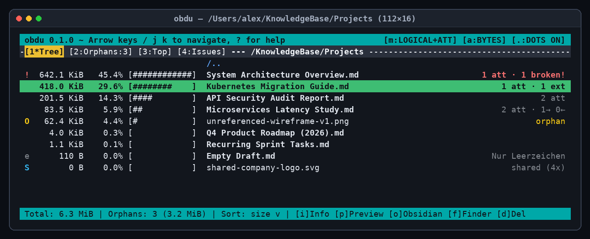

# `obdu` — Obsidian Disk Usage (`ncdu` for Obsidian Vaults)

`obdu` is a fast, standalone command-line and terminal user interface (TUI) disk usage analyzer designed specifically for **Obsidian vaults**, written in pure Go (`CGO_ENABLED=0`).

While standard `ncdu` only sees physical files and folders, `obdu` understands the complete **Obsidian reference graph** (wikilinks, Markdown links, `./_resources/` imports, `Attachment Pilot` subfolders, `TaskPulse` YAML frontmatter tasks, `Vault Pilot` `.trash/` & bookmarks, and `Drive Embedder` external media).

> [!TIP]
> **Also available as an Obsidian Plugin!**
> Prefer inspecting your vault directly inside Obsidian (on Desktop & Mobile)? Check out the companion Obsidian plugin edition: **[MarkusLitz/obsidian-obdu](https://github.com/MarkusLitz/obsidian-obdu)**.



---

## Features

- **Physical ↔ Logical Size Attribution (`m` / `Tab`) with Exact Byte Conservation:**
  Reassigns the byte weight of referenced local attachments to the active notes that embed them (splitting shared attachments across $K$ owners with exact remainder distribution so zero bytes are lost or double-counted). Opening `Attachments/` in Logical mode immediately highlights **only orphaned dead weight** at the top.
- **4-Tier Obsidian Link & Path Resolver:**
  Resolves `./` & `../` relative paths, source-folder subpaths, vault-root paths, and shortest-path basenames while masking fenced (` ``` `, `~~~`) and inline (`` ` ``) code spans.
- **Multi-Hop Reference Drill-Down (`Enter` / `Backspace`):**
  Inspect any note as a virtual directory showing its own text size, embedded local attachments, offloaded Google Drive / Web media (`[Extern]`), outgoing links (`→`), incoming backlinks (`←`), and broken links (`!`). Hop directly into any attachment to see all notes using it, or hop across linked notes with full navigation stack history.
- **Safe `.trash/` Smart Delete (`d`):**
  Detects exclusive attachments for cascade deletion, protects shared attachments still used by other notes, warns prominently on incoming backlinks, moves deleted items to `.trash/<vault-relative-path>` (with timestamp collision protection), and cleans up newly emptied per-note attachment subfolders.
- **Automatic Vault-Root Discovery:**
  Run `obdu` from any subfolder inside a vault—it automatically locates `.obsidian` upward, builds the full vault-wide link graph, and opens the TUI directly inside your current subfolder.

---

## Usage

```text
Usage:
  obdu [flags] [path]

Flags:
  -l, --logical          Start in Logical size mode (attribute referenced attachments to notes)
  -x, --exclude-hidden   Start with dot/system folders (.obsidian, .trash, .git, etc.) hidden
      --blocks           Start in filesystem Disk Block mode (st_blocks * 512) instead of Apparent Bytes
      --summary          Print a non-interactive directory & orphan summary to stdout and exit
      --json             Export full vault size & reference report as JSON to stdout and exit
      --version          Print obdu version and exit
```

### Keyboard Shortcuts

| Key(s) | Action |
| :--- | :--- |
| `↑` / `↓`, `k` / `j` | Move selection up / down (`PgUp`, `PgDn`, `Home`, `End` supported) |
| `Enter`, `→`, `l` | Enter directory, inspect note references, inspect attachment owners, or follow link |
| `Backspace`, `←`, `h` | Pop navigation stack / go to parent directory |
| `m`, `Tab` | Toggle **Physical** ↔ **Logical (with Attachments, byte-neutral)** size mode |
| `a` | Toggle **Apparent Size** (bytes) ↔ **Disk Usage** (`st_blocks * 512`) |
| `.`, `e` | Toggle visibility of hidden/system entries (`.obsidian`, `.trash`, `.git`, `node_modules`) |
| `c` | Toggle item-count column next to folders/entries |
| `g` | Cycle progress bar style: `[% + #####]` → `[#####]` → `[%]` → `Hidden` |
| `s` / `n` / `C` / `M` | Sort by **S**ize, **N**ame, Item **C**ount, **M**odification time (press again to invert) |
| `1` / `2` / `3` / `4` | Switch view: `1` Tree · `2` Orphans · `3` Largest Files · `4` Broken Links & Empty Items |
| `t` | *(In View `2`)* Cycle orphan filter: `Attachments` → `Notes` → `All` |
| `/` | Live substring filter (`Enter`/`↑`/`↓` returns focus to list; `Esc` clears filter) |
| `i` | Open **Item & Reference Info** modal |
| `p`, `Space` | **Preview**: Built-in TUI viewer for text/Markdown ($\le 512\text{ KiB}$) or QuickLook / system viewer |
| `o` | Open selected note/file in **Obsidian** (`obsidian://open`) or browser for external refs |
| `f` | Reveal selected file/folder in **Finder** / system file manager |
| `d` | Open **Smart Delete** confirmation modal |
| `r` | Rescan entire vault from disk |
| `?` | Open **Keyboard Help** modal |
| `q`, `Ctrl+C` | Quit `obdu` |

---

## Build & Install

```bash
make test
make install
```
